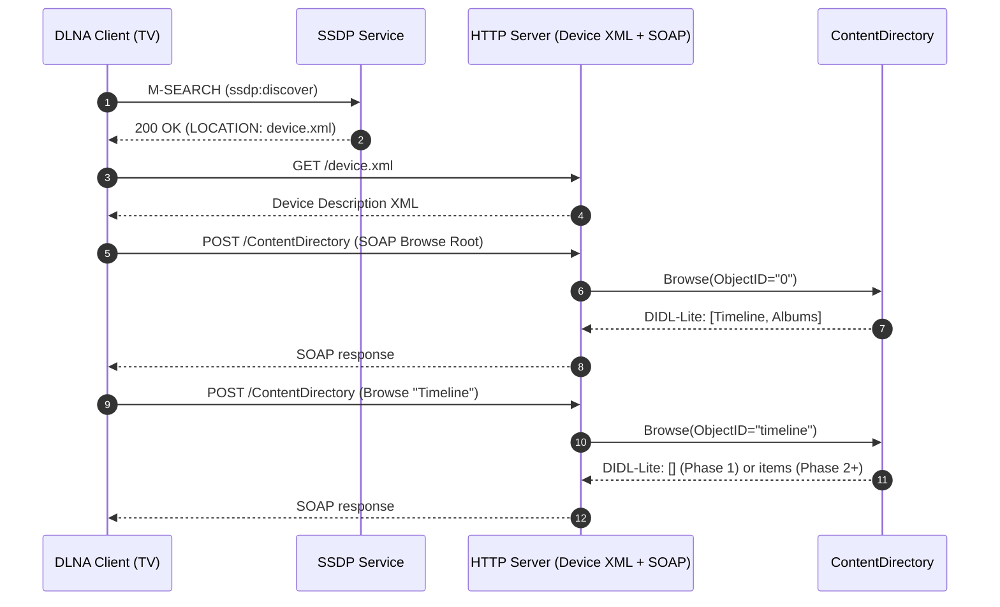
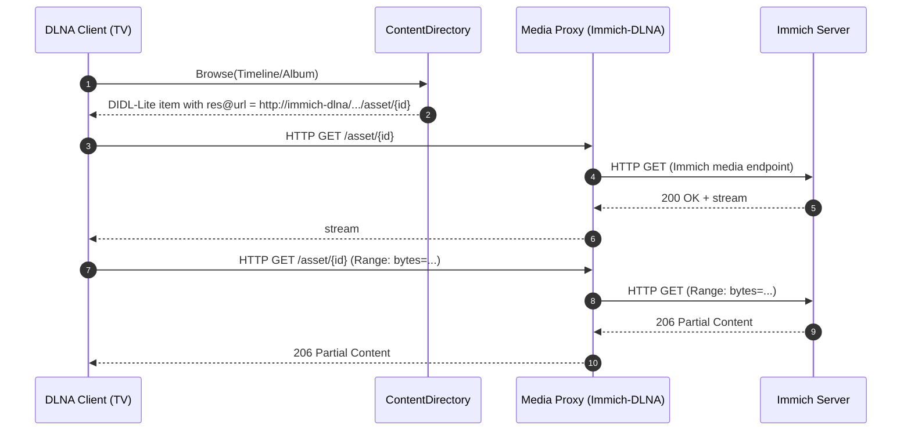

# Immich-DLNA - Architecture Plan

## Executive Summary
Immich-DLNA is a lightweight DLNA/UPnP AV **Digital Media Server (DMS)** that exposes an Immich photo/video library to home DLNA clients (e.g., LG TV) for browsing and playback. The MVP focuses on a familiar Immich-like navigation model with two top-level containers (**Timeline** and **Albums**) and progressively adds metadata, ordering fidelity, and reliable streaming (including HTTP Range support).

---

## System Context

### System Context Diagram (Overview)
Shows the system boundary for Immich-DLNA and how it interacts with users, DLNA clients, and Immich.

```mermaid
flowchart LR
  user[User
(Home viewer)]
  tv[DLNA Client
(LG TV / Console)]
  immich[Immich Server
(HTTP API)]
  inet[(Optional: DNS/Router
Home network)]

  subgraph sys[Immich-DLNA System]
    dms[Immich-DLNA Service
(DLNA DMS + HTTP Proxy)]
  end

  user -->|selects media| tv
  tv <--> |SSDP (UDP multicast)
UPnP SOAP (HTTP)
Media HTTP GET| dms
  dms <--> |Immich HTTP API
(auth via API key)| immich
  dms --- inet
```

### Key Components
- **User**: browses and plays media using the TV UI.
- **DLNA Client (TV)**: discovers DMS via SSDP and uses UPnP AV services to browse/play.
- **Immich-DLNA**: advertises as a DMS, exposes ContentDirectory, and serves media URLs.
- **Immich Server**: source of truth for assets/albums and media bytes (via API).

### Relationships
- TV ↔ Immich-DLNA: discovery (SSDP), metadata browse (SOAP), playback (HTTP GET).
- Immich-DLNA ↔ Immich: metadata retrieval and byte streaming via Immich HTTP API.

### Design Decisions
- **API-only integration**: avoids mounting Immich storage; simplifies deployment and aligns with least-privilege.
- **Immich-like UX**: two top-level containers—**Timeline** and **Albums**—to match the desired browsing mental model.

### NFR Considerations
- **Scalability:** request-driven model; caching reduces repeated Immich calls.
- **Performance:** stream bytes with backpressure; support Range to enable seek.
- **Security:** API key stored as secret/env var; minimize logged sensitive data.
- **Reliability:** retries/backoff to Immich; keep SSDP/UPnP responsive even under Immich latency.
- **Maintainability:** modular monolith keeps deployment simple while enabling clean component boundaries.

### Trade-offs
- API-only can be slower than filesystem reads and may require careful caching.

### Risks and Mitigations
- **DLNA client variability:** maintain a device test matrix; implement conservative DLNA profile defaults.
- **Docker multicast complexity:** document host networking early; provide clear run instructions.

---

## Architecture Overview

### Approach
- **Modular monolith** (single service) deployed as a single Docker container.
- **Event-driven at the edges** (SSDP multicast events; HTTP requests) but primarily **request/response**.
- **Separation of concerns**:
  - DLNA protocol surface (SSDP + device description + SOAP)
  - Immich integration (API client)
  - Media delivery (HTTP proxy with Range)
  - Caching and mapping (ObjectIDs ↔ Immich IDs)

### Content Model (MVP)
- Root contains exactly two containers:
  - **Timeline**: flat list of all assets, newest → oldest; include only Immich `visibility=timeline` and exclude trashed.
  - **Albums**: album folders sorted by album creation date, newest → oldest.
    - Each album’s contents preserve Immich-defined ordering.

### Immich API contract (OpenAPI)
Source of truth: `docs/immich-openapi-specs.json`.

- **Auth:** `x-api-key` header (recommended).
- **Timeline:**
  - `GET /timeline/buckets?order=desc&visibility=timeline&isTrashed=false`
  - `GET /timeline/bucket?timeBucket=YYYY-MM-DD&order=desc&visibility=timeline&isTrashed=false`
- **Albums:**
  - `GET /albums?isOwned=true`
  - `GET /albums?isShared=true`
  - `GET /albums/{id}`
  - `POST /search/metadata` with `albumIds=[...]` to fetch album assets
- **Assets:**
  - Metadata: `GET /assets/{id}`
  - Thumbnail: `GET /assets/{id}/thumbnail?size=thumbnail|preview`
  - Image/original: `GET /assets/{id}/original`
  - Video playback (Range): `GET /assets/{id}/video/playback`

### LG DLNA Compatibility Contract (LG webOS focus)
This section defines the **minimum “compatibility surface”** we guarantee for the LG TV’s DLNA browser, so M2/M4/M6 are implementable and verifiable.

#### Discovery & reachability
- **Network mode (MVP):** Docker **host networking required** so SSDP multicast works reliably.
- **SSDP:** respond to `M-SEARCH` for at least:
  - `ssdp:all`
  - `urn:schemas-upnp-org:device:MediaServer:1`
  - `urn:schemas-upnp-org:service:ContentDirectory:1`
  - `urn:schemas-upnp-org:service:ConnectionManager:1`
- **LOCATION URL** must be reachable from the TV and remain stable while the service is running.

#### Device Description (device.xml)
- `deviceType`: `urn:schemas-upnp-org:device:MediaServer:1`
- `friendlyName`: configurable via env var.
- **Service list includes** ContentDirectory:1 and ConnectionManager:1, each with:
  - `SCPDURL` (service description XML)
  - `controlURL` (SOAP endpoint)
  - `eventSubURL` (may be present but eventing can be a no-op for MVP)

#### Required UPnP actions (MVP-safe)
- **ContentDirectory:1**
  - `Browse` (support `BrowseMetadata` and `BrowseDirectChildren`)
  - `GetSystemUpdateID` (monotonic; can be constant for MVP)
  - `GetSearchCapabilities` (return empty)
  - `GetSortCapabilities` (return empty)
- **ConnectionManager:1**
  - `GetProtocolInfo` (return non-empty `Source`)
  - `GetCurrentConnectionIDs` (return empty/0)
  - `GetCurrentConnectionInfo` (return defaults)

#### SOAP/HTTP contract (control plane)
- Control endpoints accept HTTP `POST` with SOAP 1.1 (`Content-Type: text/xml; charset="utf-8"`).
- Clients may rely on `SOAPAction` headers, e.g. `...:ContentDirectory:1#Browse`.
- `Browse` responses must return the UPnP tuple `(Result, NumberReturned, TotalMatches, UpdateID)`, where `Result` is a **DIDL-Lite XML document encoded as a string** inside the SOAP response.

#### ObjectID scheme (stable)
- Root container: `0`
- Top-level containers: `timeline`, `albums`
- Album containers: `album:{albumId}`
- Asset items: `asset:{assetId}`

#### DIDL-Lite: minimum fields we always emit
- DIDL-Lite must be valid XML (UTF-8) and include namespaces at minimum:
  - `xmlns="urn:schemas-upnp-org:metadata-1-0/DIDL-Lite/"`
  - `xmlns:dc="http://purl.org/dc/elements/1.1/"`
  - `xmlns:upnp="urn:schemas-upnp-org:metadata-1-0/upnp/"`

For **containers** (`<container>`):
- attributes: `id`, `parentID`, `restricted="1"`
- `childCount` reports the current number of Timeline assets or child albums; album folders use Immich's asset count. Metadata falls back to zero if Immich is unavailable.
- elements: `dc:title`, `upnp:class` = `object.container.storageFolder`

For **items** (`<item>`):
- attributes: `id`, `parentID`, `restricted="1"`
- elements:
  - `dc:title`
  - `upnp:class`:
    - photos: `object.item.imageItem.photo`
    - videos: `object.item.videoItem`
  - at least one `res` element with a URL hosted by Immich-DLNA

#### `res` / `protocolInfo` contract
- **Transport:** HTTP GET only (`http-get`).
- **Baseline format:** `protocolInfo="http-get:*:<mime>:*"`.
- **Video Range hint:** for videos, include `DLNA.ORG_OP=01` when possible (signals byte-range operations), e.g.
  - `http-get:*:video/mp4:DLNA.ORG_OP=01;DLNA.ORG_CI=0`
- **MIME mapping:**
  - Prefer `AssetResponseDto.originalMimeType` for originals.
  - If unknown, fall back to `application/octet-stream`.

#### HTTP media delivery contract
- **URLs:** clients receive Immich-DLNA hosted URLs (proxy), never Immich direct URLs.
- **Images:** `GET` returns `200` with correct `Content-Type` and `Content-Length` when known.
- **Videos:** must support **HTTP Range** end-to-end:
  - Accept `Range: bytes=...`
  - Return `206 Partial Content` with `Content-Range` and `Accept-Ranges: bytes`
  - Seeking on LG must work (primary acceptance criterion for M6)

#### Pagination defaults
- If `RequestedCount` is missing or `0`, default to **50**.
- Always return correct UPnP Browse tuple: `(Result, NumberReturned, TotalMatches, UpdateID)`.

#### Failure behavior (LG-friendly)
- If Immich API is unavailable, **do not hang** the TV UI:
  - Root still returns `Timeline` + `Albums`.
  - Timeline/Albums Browse returns **empty** results with logs explaining the backend error.

---

## Component Architecture

### Component Diagram (Overview)
Shows internal modules of Immich-DLNA and their dependencies.

```mermaid
flowchart TB
  subgraph DLNA[DLNA/UPnP Surface]
    ssdp[SSDP Service
(UDP multicast/unicast)]
    devdesc[Device Description
(XML over HTTP)]
    cd[ContentDirectory
(SOAP: Browse/Search)]
    cm[ConnectionManager
(SOAP: GetProtocolInfo)]
  end

  subgraph HTTP[HTTP Surface]
    health[Health/Info Endpoint]
    media[Media Proxy Endpoint(s)
(HTTP GET + Range)]
  end

  subgraph Core[Core Domain]
    model[Content Model
(Container/Item mapping)]
    ids[ObjectID / URL Mapper
(stable IDs)]
    cache[Metadata Cache
(TTL, in-memory)]
  end

  subgraph Imm[Immich Integration]
    client[Immich API Client
(auth, pagination, retries)]
  end

  ssdp --> devdesc
  devdesc --> cd
  devdesc --> cm

  cd --> model
  model --> ids
  model --> cache
  cache --> client
  model --> client

  media --> ids
  media --> client

  health --> client
```

### Key Components
- **SSDP Service**: discovery/advertisements and M-SEARCH responses.
- **Device Description**: UPnP XML describing services and endpoints.
- **ContentDirectory**: exposes Browse results in DIDL-Lite.
- **ConnectionManager**: minimal compatibility surface for many TVs.
- **Content Model**: builds Timeline/Albums containers and items.
- **ObjectID/URL Mapper**: stable mapping from DLNA object IDs to Immich asset/album IDs and streaming URLs.
- **Metadata Cache**: reduces repeated Immich API calls.
- **Immich API Client**: handles auth, pagination, timeouts, and resiliency.
- **Media Proxy**: serves bytes to DLNA clients, supports Range.

### Relationships
- ContentDirectory drives read paths: Browse → content model → cache/client → DIDL.
- Media Proxy drives stream paths: HTTP GET → client → streaming response.

### Design Decisions
- **Stable IDs** prevent clients from losing position/history.
- **Cache is optional but recommended** due to Timeline/Album browsing repeating calls.

### NFR Considerations
- **Scalability:** concurrency via async I/O; caching; pagination.
- **Performance:** avoid buffering full media; favor streaming with chunking.
- **Security:** strict config validation; avoid SSRF by only calling configured Immich base URL.
- **Reliability:** isolate SSDP/UPnP responsiveness from Immich slowness; circuit-breaker style behavior.
- **Maintainability:** module boundaries allow swapping DLNA stack or Immich endpoints later.

### Trade-offs
- Implementing minimal UPnP stack yields control but increases protocol complexity; using a framework reduces protocol risk but may constrain DLNA quirks handling.

### Risks and Mitigations
- **SOAP/DIDL correctness:** validate with at least one strict DLNA client and one lenient one; keep responses minimal and standards-compliant.

---

## Deployment Architecture

### Deployment Diagram (Overview)
Shows how Immich-DLNA is deployed in a home network, including multicast and HTTP flows.

```mermaid
flowchart LR
  subgraph LAN[Home LAN]
    tv[DLNA Client (TV)]
    host[Home Server / NAS]
    immich[Immich Server]

    subgraph docker[Docker Runtime]
      dms[Immich-DLNA Container]
    end
  end

  tv <--> |SSDP UDP 1900
HTTP SOAP
HTTP media| dms
  dms <--> |HTTP API + media bytes| immich
  host --- docker
```

### Key Components
- **Immich-DLNA container**: single runtime unit.
- **Immich server**: reachable over LAN (HTTP/HTTPS).
- **TV**: uses multicast discovery + HTTP requests.

### Relationships
- DLNA discovery requires multicast; many Docker setups require **`--network host`** (or equivalent) to properly receive/respond on SSDP.

### Design Decisions
- **Docker-first** simplifies repeatable deployment.
- Prefer **host networking** for MVP to minimize multicast troubleshooting.

### NFR Considerations
- **Scalability:** single instance is typically sufficient for home; can scale vertically.
- **Performance:** co-locate container near Immich server to reduce latency.
- **Security:** run with least privileges; restrict outbound to Immich; optional IP allowlist for clients.
- **Reliability:** restart policy; health checks; logs for diagnosis.
- **Maintainability:** config via environment variables; immutable container builds.

### Trade-offs
- Host networking simplifies SSDP but reduces network isolation.

### Risks and Mitigations
- **Multicast blocked by network gear:** document router/switch requirements; provide troubleshooting steps and alternative network modes if needed.

---

## Data Flow

### Data Flow Diagram (Overview)
Illustrates how metadata and media bytes flow from Immich to DLNA clients through Immich-DLNA.

```mermaid
flowchart TD
  tv[DLNA Client] -->|Browse (SOAP)| cd[ContentDirectory]
  cd -->|query containers/items| model[Content Model]
  model -->|cache lookup| cache[(Metadata Cache)]
  cache -->|miss| immich[Immich API]
  immich -->|albums/assets JSON| model
  model -->|DIDL-Lite response| tv

  tv -->|HTTP GET media URL
(+ Range)| proxy[Media Proxy]
  proxy -->|stream request| immichBytes[Immich Media Endpoint]
  immichBytes -->|bytes stream| proxy
  proxy -->|bytes stream| tv
```

### Key Components
- **Metadata plane**: Browse responses built from Immich metadata.
- **Media plane**: HTTP streaming proxy path.

### Relationships
- Metadata Browse can be served from cache; media streaming is typically passthrough streaming.

### Design Decisions
- Separate metadata vs media paths to isolate performance and simplify caching.

### NFR Considerations
- **Performance:** metadata cache; streaming proxy avoids buffering.
- **Reliability:** timeouts and retries for metadata; conservative retrying for media streams (avoid duplicating bytes mid-stream).
- **Security:** sanitize/validate IDs; do not expose Immich API key to clients.

### Trade-offs
- Proxying increases bandwidth through Immich-DLNA but provides stable URLs and centralizes access control.

### Risks and Mitigations
- **Large Timeline lists:** strict pagination; conservative default page sizes.

---

## Key Workflows

### Sequence Diagram 1 — Discovery and browsing (MVP)
#### Overview
Shows how a TV discovers the DMS and browses Root → Timeline/Albums.



#### Key Components
- SSDP handles discovery.
- Device description provides service endpoints.
- ContentDirectory returns two containers, then their children.

#### Relationships
- Browse is the critical UX path; Root must be stable and minimal.

#### Design Decisions
- Implement **Timeline** and **Albums** as first-class containers from day 1.

#### NFR Considerations
- **Reliability:** browsing Root must remain responsive even if Immich is down (Phase 1 and partial Phase 2 behavior).
- **Maintainability:** keep Root logic simple.

#### Trade-offs
- Phase 1 returns empty children, enabling protocol validation before Immich integration.

#### Risks and Mitigations
- Some clients aggressively cache; stable IDs and consistent responses mitigate UI weirdness.

---

### Sequence Diagram 2 — Playback via HTTP proxy (Phase 3)
#### Overview
Shows how a DLNA client retrieves a resource URL and then streams bytes with Range requests.



#### Key Components
- ContentDirectory publishes resource URLs.
- Media Proxy translates DLNA HTTP requests into Immich media requests.

#### Relationships
- Range support must be preserved end-to-end for seeking.

#### Design Decisions
- Always proxy through Immich-DLNA to avoid exposing Immich directly and to keep URLs stable for clients.

#### NFR Considerations
- **Performance:** streaming with minimal buffering; keep latency low.
- **Reliability:** handle Immich disconnects gracefully; close client connection with meaningful HTTP status.
- **Security:** no secrets in URLs; validate asset IDs.

#### Trade-offs
- Double-hop streaming increases CPU/network use on Immich-DLNA host.

#### Risks and Mitigations
- **Some clients require specific DLNA protocolInfo:** implement conservative protocolInfo values and adjust based on observed LG behavior.

---

## Phased Development (Recommended)

### Phase 1: Initial Implementation (Protocol skeleton)
**Goal:** Implement a custom DLNA server that exposes **two empty folders**: Timeline and Albums.

- SSDP discovery + device XML.
- ContentDirectory returns Root children: Timeline, Albums.
- Timeline/Albums children are empty.

**Why:** validates multicast networking and DLNA protocol correctness on the target TV before adding Immich complexity.

### Phase 2: Browsing metadata (Timeline + Albums)
- Integrate Immich API for album and asset metadata.
- Populate Albums and Timeline according to locked taxonomy and ordering rules.
- Implement pagination robustly.

### Phase 3: Playback / streaming
- Add HTTP proxy endpoints for media bytes.
- Add Range support and correct MIME types.

### Migration Path
- Phase 1 → Phase 2: Introduce Immich API client and cache behind the ContentDirectory module; Root container remains unchanged.
- Phase 2 → Phase 3: Add Media Proxy module and update DIDL-Lite `res` URLs to point at proxy endpoints.

---

## Non-Functional Requirements Analysis

### Scalability
- Primary scale axis is library size and client browsing patterns.
- Use pagination for Timeline; cache album lists and recent Timeline pages.

### Performance
- Stream media without full buffering.
- Support Range end-to-end.
- Use TTL cache for metadata; keep SOAP responses minimal.

### Security
- Immich API key stored only server-side.
- Avoid logging Authorization headers.
- Optional IP allowlist for DLNA clients.
- Validate all ObjectIDs and asset IDs (treat client input as untrusted).

### Reliability
- Timeouts and bounded retries for Immich metadata calls.
- Keep SSDP responses and device XML always available.
- Graceful degradation: if Immich is down, Root still browsable; Timeline/Albums can return empty + error logs.

### Maintainability
- Modular internal structure.
- Clear configuration contract and documentation.
- Compatibility layer for client quirks isolated from core logic.

---

## Risks and Mitigations
- **Docker + multicast/SSDP pitfalls:** default to host networking for MVP; document troubleshooting.
- **DLNA metadata strictness (DIDL-Lite):** start minimal, validate with real devices, extend incrementally.
- **Timeline size:** enforce pagination and avoid generating huge DIDL responses.
- **Immich API changes:** version-pin Immich API usage where possible; isolate in API client module.

---

## Technology Stack Recommendations
- **Language:** Python **3.11+** (optionally target 3.14)
- **Project management:** `pyproject.toml` + **uv** (dependency + lockfile)
- **Quality gates:** **mypy** (type checking) + **flake8** (lint), with flake8 config via **flake8-pyproject**
- **Runtime model:** asyncio-based networking
- **HTTP server:** an async HTTP server capable of efficient streaming and Range support
- **XML handling:** robust XML library for SOAP parsing and DIDL-Lite generation
- **Containerization:** Docker, with documented host-network option for SSDP
- **Observability:** structured logs + health endpoint; optional lightweight metrics later

---

## Next Steps
1. Finalize the UPnP/DLNA foundation choice (framework vs minimal custom) and define the exact UPnP service surface for MVP.
2. Specify the Root/Timeline/Albums ObjectID scheme and the minimum DIDL-Lite fields needed for LG TV compatibility.
3. Define the MVP test matrix (at least LG TV + one additional DLNA client app) and acceptance criteria for Phase 1.
